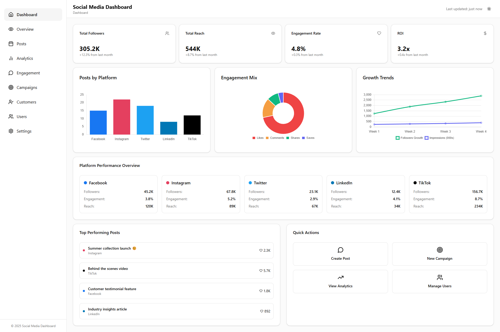

# SocialDash — Social Media Management Dashboard

A modern, responsive social media management and analytics dashboard built with Next.js, React, TypeScript, and Tailwind CSS.

SocialDash provides a centralized interface for monitoring social media performance, exploring audience insights, viewing content, and analyzing marketing campaigns.

**Project Status:** Frontend demonstration using sample data.

## Project Preview



## Overview

SocialDash is a frontend-focused social media management application designed to simplify the presentation and analysis of social media activities.

The project brings together performance analytics, post management interfaces, customer insights, campaign monitoring, and engagement tracking within a unified dashboard.

It demonstrates modern frontend development practices, including reusable React components, responsive layouts, interactive data visualizations, and theme customization.

## Features

### 1. Dashboard and Overview

- Social media performance summaries
- Interactive statistics cards
- Audience growth visualizations
- Platform engagement comparisons
- Performance trend charts
- Responsive dashboard layouts
- Interactive overview controls

### 2. Post Management

- View social media posts
- Display scheduled, published, draft, and failed post statuses
- View post engagement metrics
- Display associated social media platforms
- View content types and campaign associations
- Post creation, editing, and deletion interface placeholders

### 3. Analytics and Reporting

- Follower growth analysis
- Reach and impression visualizations
- Engagement rate comparisons
- Platform performance metrics
- Conversion statistics
- Interactive charts using Chart.js

### 4. Engagement Monitoring

- Recent engagement activity
- Likes, comments, and shares
- Post interaction history
- Engagement overview cards

### 5. Campaign Management

- Marketing campaign overview
- Campaign status tracking
- Budget and spending summaries
- Conversion statistics
- Click-through rate (CTR)
- Cost per click (CPC)
- Return on ad spend (ROAS)
- Campaign performance charts

### 6. Customer Management

- Customer profile information
- Customer segmentation
- Customer interaction summaries
- Spending and order metrics
- Customer engagement insights
- Customer analytics visualizations

### 7. User Management

- User profile listings
- Admin, editor, and viewer role labels
- Active, invited, and suspended status indicators
- User management interface

Authentication, account invitations, and role-based authorization are not yet implemented.

### 8. Settings and Customization

- Light and dark mode
- System theme support
- Responsive sidebar navigation
- Reusable UI components
- Appearance customization
- Account settings placeholder

## Technology Stack

| Category | Technology |
|----------|------------|
| Framework | Next.js 15 |
| Frontend | React 19 |
| Language | TypeScript 5 |
| Styling | Tailwind CSS 4 |
| Charts | Chart.js, React Chart.js 2 |
| UI Components | Radix UI |
| Icons Library | Lucide React |
| Theme Management | next-themes |
| UI Utilities | clsx, tailwind-merge |
| Package Manager | npm |

### Additional Dependencies

The project also includes:

- TanStack React Query
- Zustand
- Socket.IO Client
- class-variance-authority

These libraries provide a foundation for future API integration, state management, and real-time communication.

## Getting Started

### Prerequisites

Before running the application, install:

- Node.js 20 or later
- npm
- Git

### 1. Clone the Repository

```bash
git clone https://github.com/boldhab/scoial-manager.git
```

### 2. Navigate to the Project

```bash
cd scoial-manager
```

### 3. Install Dependencies

```bash
npm install
```

### 4. Start the Development Server

```bash
npm run dev
```

### 5. Open the Application

Open your browser and navigate to:

```text
http://localhost:3000
```

### Production Build

```bash
npm run build
npm run start
```

## Project Structure

```text
scoial-manager/
|
|-- public/
|   |-- demo.png
|   |-- *.svg
|
|-- docs/
|   |-- api.md
|   |-- components.md
|   |-- deployment.md
|
|-- src/
|   |-- app/
|   |   |-- favicon.ico
|   |   |-- globals.css
|   |   |-- layout.tsx
|   |   |-- page.tsx
|   |
|   |-- components/
|   |   |-- sections/
|   |   |   |-- DashboardSection.tsx
|   |   |   |-- OverviewSection.tsx
|   |   |   |-- PostsSection.tsx
|   |   |   |-- AnalyticsSection.tsx
|   |   |   |-- EngagementSection.tsx
|   |   |   |-- CampaignsSection.tsx
|   |   |   |-- CustomersSection.tsx
|   |   |   |-- UsersSection.tsx
|   |   |   |-- SettingsSection.tsx
|   |   |
|   |   |-- ui/
|   |   |   |-- badge.tsx
|   |   |   |-- button.tsx
|   |   |   |-- card.tsx
|   |   |   |-- dialog.tsx
|   |   |   |-- loading-spinner.tsx
|   |   |   |-- progress.tsx
|   |   |   |-- skeleton.tsx
|   |   |   |-- toast.tsx
|   |   |   |-- tooltip.tsx
|   |   |
|   |   |-- DashboardHome.tsx
|   |   |-- Sidebar.tsx
|   |   |-- ThemeToggler.tsx
|   |
|   |-- hooks/
|   |   |-- useAccessibility.ts
|   |   |-- useResponsive.ts
|   |
|   |-- lib/
|       |-- utils.ts
|
|-- components.json
|-- eslint.config.mjs
|-- next.config.ts
|-- package.json
|-- package-lock.json
|-- postcss.config.mjs
|-- tsconfig.json
|-- README.md
```

## Application Architecture

The application follows a component-based architecture using Next.js App Router.

```text
Next.js Application
        |
        v
    Root Layout
        |
        v
     Main Page
        |
        |-- Sidebar Navigation
        |
        |-- Theme Toggler
        |
        |-- Dashboard Home
                |
                |-- Dashboard
                |-- Overview
                |-- Posts
                |-- Analytics
                |-- Engagement
                |-- Campaigns
                |-- Customers
                |-- Users
                |-- Settings
                        |
                        v
                 Reusable UI
                   Components
```

### Architecture Principles

**Component Reusability**

Shared components are used throughout the application to maintain visual consistency and reduce code duplication.

**Modular Development**

Dashboard functionality is organized into separate sections, making the codebase easier to maintain and extend.

**Responsive Design**

The interface adapts to different screen sizes, including desktop, tablet, and mobile devices.

**Client-Side Interaction**

React state manages dashboard navigation and interactive UI behavior.

**Data Visualization**

Chart.js is used to present social media statistics through graphical representations.

## Data Management

The current implementation primarily uses local demonstration datasets.

| Module | Current Data Source |
|--------|---------------------|
| Dashboard | Static sample metrics |
| Overview | Local demonstration data |
| Posts | In-component sample records |
| Analytics | Static chart datasets |
| Engagement | Sample activity records |
| Campaigns | In-component campaign data |
| Customers | In-component customer data |
| Users | Sample user records |
| Settings | Client-side theme settings |

### Current Limitations

- No production backend
- No persistent database
- No implemented user authentication
- No enforced role-based authorization
- No real social media API integration
- No automatic post publishing
- No server-side post scheduling
- No live social media analytics
- Some action buttons are placeholders

These capabilities are planned for future development.

## Available Scripts

| Command | Description |
|---------|-------------|
| `npm run dev` | Start the development server |
| `npm run build` | Build the application for production |
| `npm run start` | Run the production server |
| `npm run lint` | Run the configured lint command |

**Note:** The current `lint` script uses `next lint`. For Next.js 15 and ESLint 9 compatibility, update the script in `package.json` to use `eslint .`.

## Documentation

Additional project documentation is available:

- [API Reference](docs/api.md)
- [Component Documentation](docs/components.md)
- [Deployment Guide](docs/deployment.md)

The API reference describes a proposed backend integration contract rather than an implemented API.

## Future Improvements

### Backend Development

- Implement REST APIs
- Integrate a database
- Add authentication and authorization
- Implement CRUD operations
- Add secure session management

### Social Media Integration

- Connect social media accounts
- Integrate supported platform APIs
- Implement content scheduling
- Enable post publishing
- Retrieve real engagement statistics

### Advanced Analytics

- Dynamic reporting
- Date-range filtering
- Custom dashboards
- Data export functionality
- Real-time metric updates

### Production Readiness

- Automated testing
- CI/CD integration
- Performance optimization
- Accessibility improvements
- Security testing
- Production deployment

## Contributing

Contributions and suggestions are welcome.

To contribute:

1. Fork the repository.
2. Create a new feature branch.
3. Implement your changes.
4. Commit your changes.
5. Push your branch.
6. Open a pull request.

Example:

```bash
git checkout -b feature/new-feature
git add .
git commit -m "feat: implement new feature"
git push origin feature/new-feature
```

## Developer

**Habtamu Befekadu**

Software Engineering Student | Full-Stack Web and Mobile Developer

Interested in developing modern web applications, mobile applications, and scalable software systems.

**GitHub:** [github.com/boldhab](https://github.com/boldhab)


## Support

If you find this project useful, consider starring the repository.

Feedback, suggestions, and contributions are appreciated.

---

**Developed by Habtamu Befekadu**

Built with Next.js, React, TypeScript, and Tailwind CSS.
